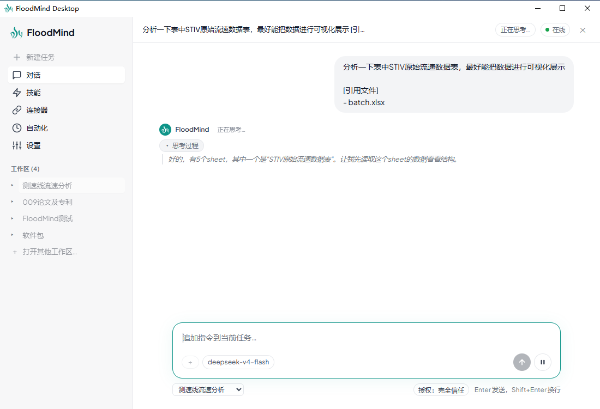
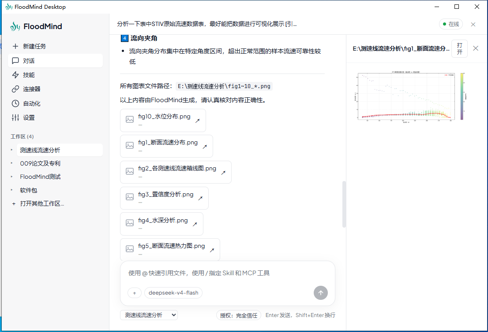
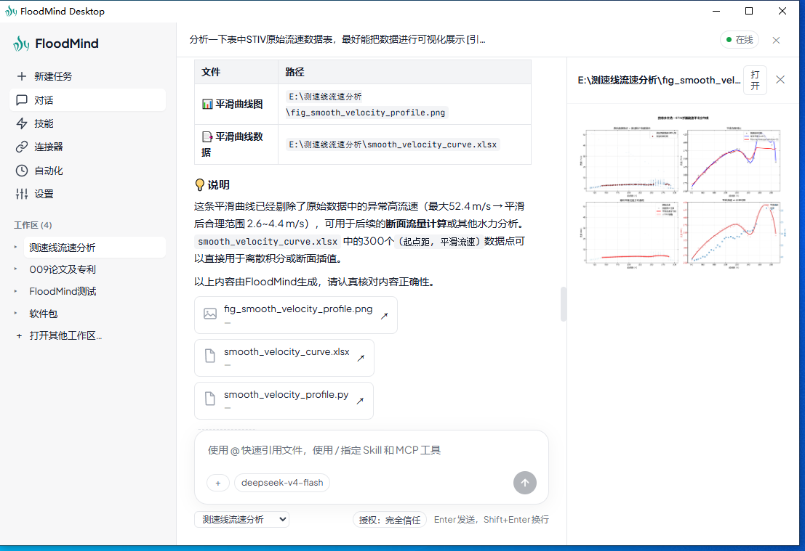
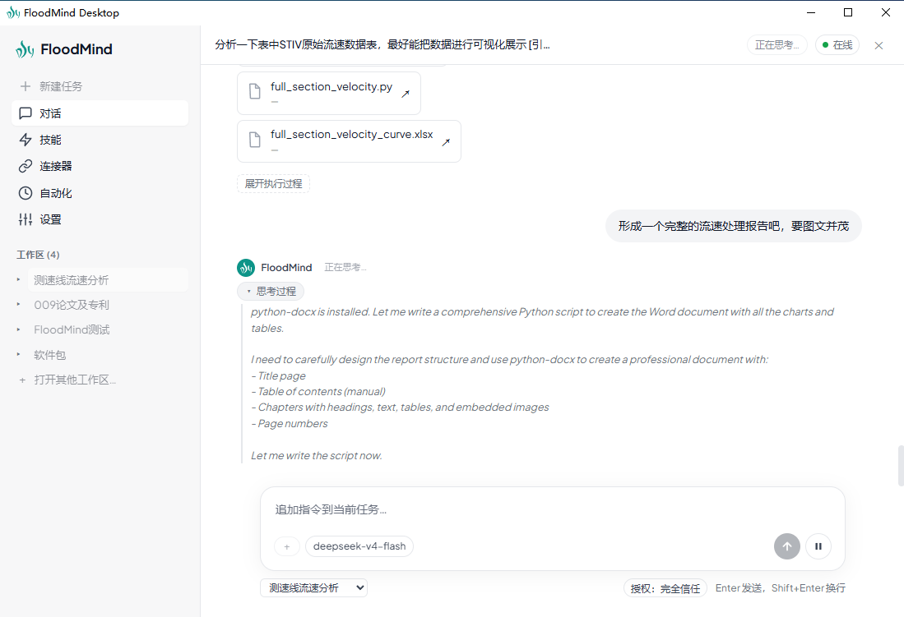
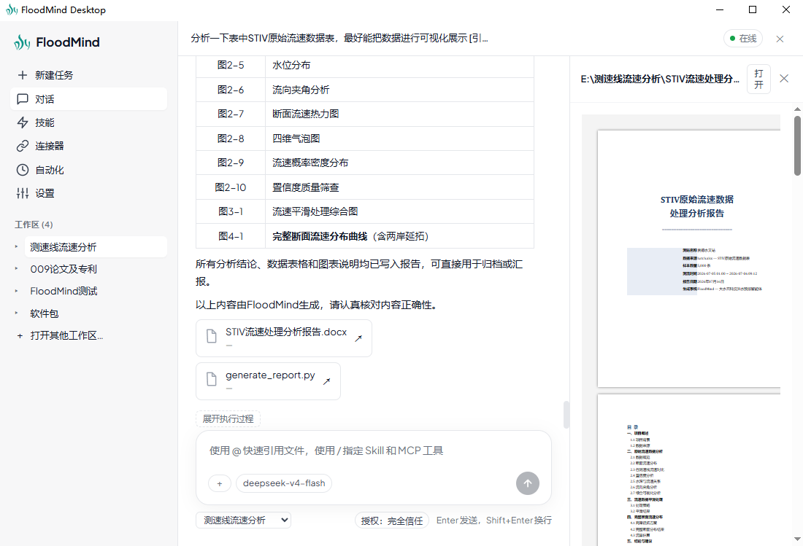
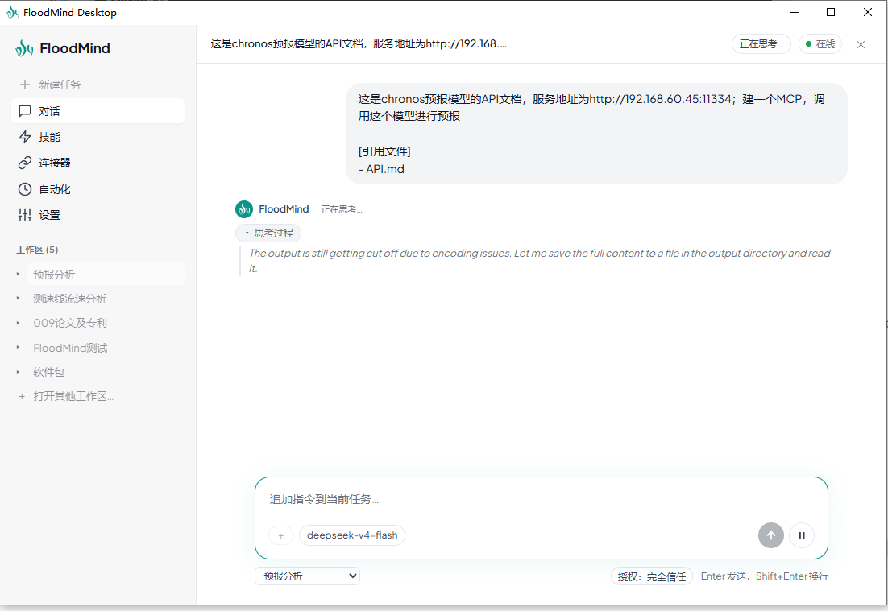
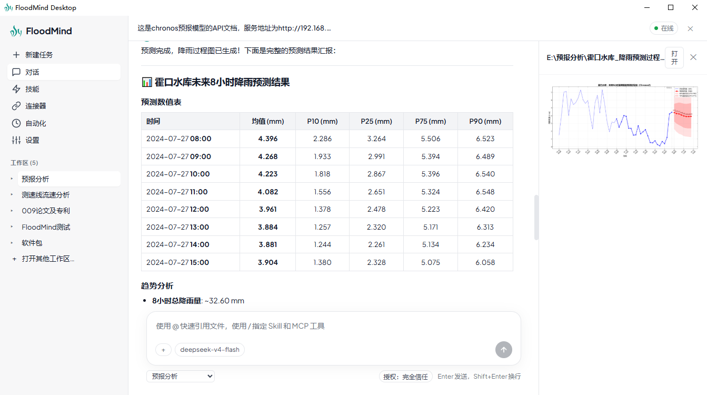

# FloodMind Desktop

<p align="center">
  
  
</p>

**FloodMind Desktop** — 你的全能水文智能助手。基于 FloodMind AI Agent SDK 的桌面客户端，可直接读写工作区文件，完成降雨径流分析、洪水预报与水情报表生成。支持接入多家大模型，搭载 MCP 工具扩展、定时任务、技能系统等能力。

## 技术栈

| 层 | 技术 |
|---|------|
| 桌面框架 | Tauri 2 (Rust) |
| 前端 | React 19 + TypeScript + Vite |
| AI 引擎 | Python Flask Sidecar + FloodMind SDK |
| 打包 | Nuitka (Python → exe) + NSIS 安装包 |

## 功能预览

|  |  |
|--|--|
| **AI 对话** — 多轮对话、流式输出、思考链、工具调用、计划面板 |  |
| **工作区** — 打开本地文件夹、文件浏览、拖拽引用、Office 预览 |  |
| **模型配置** — 支持 DeepSeek / 智谱 / 通义千问 / Moonshot / MiniMax / 自定义 OpenAI 兼容 / Ollama 本地 |  |
| **定时任务** — 每日/一次性自动化任务，后台无人值守执行 |  |
| **Skills** — 内置技能 + 自定义 Skill，可启用/禁用 |  |
| **MCP 服务器** — 配置外部工具服务（stdio / SSE），Agent 热插拔接入 |  |
| **文件预览** — Markdown、代码、图片、PDF、Word/Excel/PPT 内置渲染 |  |
| **权限控制** — 三级授权（完全信任 / 首次询问 / 总是询问） |  |

## 快速开始

### 前置条件

- Node.js 20+
- Python 3.11+ with `floodmind` SDK installed
- Rust toolchain (for Tauri)

### 安装 FloodMind SDK

```bash
pip install git+https://github.com/dancepandas/FloodMind.git
```

### 开发运行

```bash
cd sidecar
pip install -r requirements.txt   # Flask, floodmind, etc.

cd ..
npm install
npm run tauri dev
```

### 打包安装包

```bash
# 一键：编译 sidecar (Nuitka) + Tauri 打包 (NSIS)
bash pack.sh

# 安装包位于
# src-tauri/target/release/bundle/nsis/FloodMind Desktop_*.exe
```

### 模型配置

首次启动后，在 **设置 → 模型** 页面配置至少一个服务商的 API Key，保存后即可开始对话。

支持的模型服务商：

| 服务商 | 文档 |
|--------|------|
| DeepSeek | [API 文档](https://api-docs.deepseek.com/) |
| 智谱 AI (GLM) | [API 文档](https://docs.bigmodel.cn/) |
| 月之暗面 (Kimi) | [API 文档](https://platform.kimi.ai/docs) |
| 通义千问 (Qwen) | [API 文档](https://help.aliyun.com/zh/model-studio/qwen-api-via-dashscope) |
| MiniMax | [API 文档](https://platform.minimaxi.com/docs/) |
| OpenAI 兼容 | 任意 OpenAI 兼容接口 |
| Ollama | 本地模型 |

### 配置 MCP 服务器

连接外部工具扩展 Agent 能力（`settings → MCP`）。配置示例：

**stdio 方式**（Python 脚本）：
```json
{
  "name": "my-mcp-tool",
  "transport": "stdio",
  "command": "python",
  "args": ["path/to/mcp_server.py"],
  "env": {}
}
```

**SSE 方式**（远程服务）：
```json
{
  "name": "remote-service",
  "transport": "sse",
  "url": "http://192.168.1.100:8000/sse"
}
```

Agent 在对话中可通过 `LoadMcpServer` 工具动态接入新的 MCP 服务，接入后自动持久化并在 MCP 列表显示。

## 项目结构

```
FloodMind-desktop/
├── src/                          # React 前端
│   ├── components/               # UI 组件
│   │   ├── office/               # Office 文件渲染器 (docx/xlsx/pptx)
│   │   ├── Composer.tsx          # 输入框（文件引用 / 技能 / MCP）
│   │   ├── Conversation.tsx      # 对话视图
│   │   ├── PreviewPanel.tsx      # 文件预览面板
│   │   ├── SettingsView.tsx      # 设置（模型 / 角色 / 反馈）
│   │   ├── Sidebar.tsx           # 侧边栏（工作区 / 会话 / 导航）
│   │   └── TopBar.tsx            # 顶栏（标题 / 状态 / 计划）
│   ├── state/                    # Zustand 状态管理
│   │   ├── chat-store.ts         # 对话状态（发送 / 流式 / 权限）
│   │   ├── config-store.ts       # 模型 / Soul 配置
│   │   ├── conversation-store.ts # 会话历史（按工作区隔离）
│   │   ├── workspace-store.ts    # 工作区管理
│   │   └── catalog-store.ts      # Skills / MCP 管理
│   └── lib/                      # 工具库
├── src-tauri/                    # Tauri 2 (Rust)
│   └── src/
│       ├── lib.rs                # Tauri 命令 + 窗口管理
│       └── sidecar.rs            # Python Sidecar 生命周期
├── sidecar/                      # Python Flask Sidecar
│   └── floodmind_desktop_sidecar/
│       ├── app.py                # API 路由（聊天 / 会话 / 工作区 / MCP / 任务）
│       ├── floodmind_agent.py    # FloodMind SDK 集成
│       ├── config_api.py         # 模型配置读写
│       ├── conversation_store.py # 会话持久化
│       ├── workspace.py          # 工作区状态管理
│       ├── catalog_api.py        # Skills / MCP 管理
│       └── scheduled_runner.py   # 定时任务运行器
├── pack.sh                       # 一键打包脚本
├── sidecar/build_sidecar.sh      # Nuitka 编译 sidecar
└── sidecar/entry.py              # Sidecar 入口
```

## License

MIT
