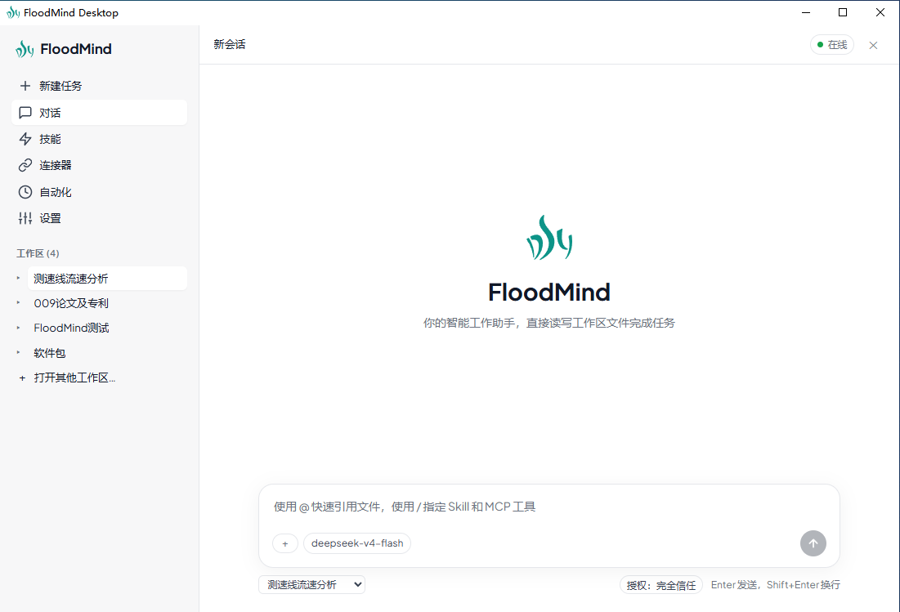

<p align="center">
  
</p>

# FloodMind Desktop

FloodMind Desktop 是一款基于 [FloodMind AI Agent SDK](https://github.com/dancepandas/FloodMind) 的**桌面端智能助手**，专为水文水利业务场景设计。它能在本地工作区中自主读写文件、调用外部工具、执行定时任务，完成降雨径流分析、洪水预报、水情报表生成等专业工作。

**核心理念**：不是聊天机器人，而是能直接操作你文件夹里真实数据的 AI 同事。

---

## 功能概览

### AI 对话与工具调用
- 多轮流式对话，支持思考链可视化、执行计划面板、Token 用量显示
- Agent 可自主调用 30+ 内置工具（文件读写、Bash 执行、网络请求、代码解释器等）
- 通过 `@文件` 引用工作区文件，`/技能` 或 `/MCP工具` 精准调度能力

### 多模型接入
内置 7 个服务商的预置配置，API Key 填入即用：

| DeepSeek | 智谱 GLM | 通义千问 | Moonshot (Kimi) |
|----------|----------|----------|-----------------|
| MiniMax | OpenAI 兼容（任意第三方接口） | Ollama（本地模型） |

每项配置独立保存，支持随时切换激活的模型与服务商。页面内「文档」按钮直达各服务商官方 API 文档。

### 工作区管理
- 打开任意本地文件夹作为工作区，Agent 的读写操作限定在工作区范围内
- 侧边栏展示当前及最近工作区列表，支持一键切换或从列表移除
- 内置文件浏览器，支持 Markdown、代码高亮、图片、PDF、**Word / Excel / PowerPoint** 原生渲染预览

### MCP 工具扩展
- 支持 **stdio**（本地进程）和 **SSE**（远程服务）两种 MCP 传输协议
- 管理界面可新建、编辑、删除、测试 MCP 服务器，实时展示连接状态与工具调用健康度
- Agent 在对话中通过 `LoadMcpServer` 工具热插拔接入的外部服务**自动持久化**到配置，重启不丢失

### 会话管理
- 会话按工作区隔离存储，切换工作区即切换上下文
- 首轮对话完成后，Agent **自动调用 LLM 生成中文会话标题**（左侧列表和顶部栏即时刷新）
- 支持会话删除、历史回溯

### 定时自动化任务
- 支持**一次性**和**每日定时**两种任务模式
- 后台无人值守执行，Agent 自动批准所有工具调用（不受交互式权限模式限制）
- Agent 对话中通过 `ScheduleTask` 创建的定时任务自动纳管到自动化列表

### 权限控制
三级授权策略，满足不同场景：

| 模式 | 行为 |
|------|------|
| 完全信任 | 所有工具调用自动批准，无弹窗 |
| 首次询问 | 每个工具首次调用时询问，同会话内后续自动批准 |
| 总是询问 | 每次工具调用都弹窗等待用户确认 |

### Skills 技能系统
- 内置技能 + 自定义 Skill 注册
- 可视化启用/禁用，支持编辑 Skill 的描述、提示词、分类、版本

---

## 系统架构

```
┌─────────────────────────────────────────────┐
│                 Tauri 2 (Rust)               │
│  窗口管理 · 文件对话框 · 系统托盘 · 自动更新  │
├─────────────────────────────────────────────┤
│           React 19 + TypeScript              │
│  Zustand 状态管理 · Vite 构建 · HMR 热更新   │
├─────────────────────────────────────────────┤
│      Python Flask Sidecar (localhost:*)      │
│  REST API · FloodMind SDK · 文件/会话/任务   │
├─────────────────────────────────────────────┤
│           FloodMind Agent SDK                │
│  LLM 调用 · 工具执行 · 记忆管理 · 权限服务    │
└─────────────────────────────────────────────┘
```

Tauri 进程负责启动和管理 Python Sidecar 子进程。前端通过本地 HTTP API 与 Sidecar 通信，Sidecar 封装 FloodMind SDK 的所有能力并暴露给 UI。Rust 层提供文件对话框、Tray、窗口管理等原生能力。

---

## 快速开始

### 环境要求

- **Node.js** ≥ 20
- **Python** ≥ 3.11
- **Rust** toolchain（[rustup](https://rustup.rs/) 安装）
- Windows 10+（Tauri 2 跨平台，当前仅适配 Windows）

### 1. 安装 FloodMind SDK

```bash
pip install git+https://github.com/dancepandas/FloodMind.git
```

### 2. 安装 Python 依赖

```bash
cd sidecar
pip install -r requirements.txt
```

### 3. 安装前端依赖

```bash
# 回到项目根目录
npm install
```

### 4. 启动开发环境

```bash
npm run tauri dev
```

首次启动会编译 Rust 代码，约 1-2 分钟。后续热更新秒级生效。Sidecar 自动拉起，Flask 监听随机端口，前端通过 `/api/health` 轮询就绪。

### 5. 配置模型

打开应用 → 左侧「设置」→ 选择服务商 → 填入 API Key → 保存。即可在输入框中开始对话。

---

## 打包发布

```bash
bash pack.sh
```

脚本流程：
1. **Nuitka 编译** `sidecar/entry.py` → `floodmind-sidecar.exe`（standalone，包含 Python 运行时与所有依赖）
2. **Stage**：将 dist 目录复制到 `src-tauri/resources/`
3. **Tauri Build**：编译 Rust Release + 打包前端 → NSIS 安装包

产物：`src-tauri/target/release/bundle/nsis/FloodMind Desktop_<version>_x64-setup.exe`

---

## 配置参考

### 模型设置 (`~/.floodmind/settings.json`)

```json
{
  "providers": {
    "deepseek": {
      "name": "DeepSeek",
      "base_url": "https://api.deepseek.com/v1",
      "api_key": "sk-xxx",
      "models": [
        {
          "id": "deepseek-v4-flash",
          "context_window": 1048576,
          "default_max_tokens": 65536,
          "default_temperature": 0.3
        }
      ]
    }
  },
  "desktop": {
    "activeModel": "deepseek-v4-flash",
    "activeProvider": "deepseek",
    "enableReasoning": true,
    "enableSearch": false
  },
  "permissions": {
    "mode": "always-trust"
  }
}
```

`desktop.*` 块由应用 UI 维护，SDK 迁移不会覆盖。`permissions.mode` 取值：`always-trust` | `trust-once` | `always-ask`。

### MCP 配置 (`<app_data>/mcp.json`)

```json
[
  {
    "name": "hydro-rag",
    "transport": "stdio",
    "command": "python",
    "args": ["E:/tools/hydro_rag_mcp.py"],
    "env": {}
  }
]
```

界面操作或 Agent `LoadMcpServer` 创建后自动写入，无需手动编辑。

### 角色设定

- `<app_data>/SOUL.md` — Agent 的人设与行为准则
- `<app_data>/AGENTS.md` — 全局行为规则（编码风格、文档模板、用词偏好）

在应用「设置 → 角色」页面编辑，保存后立即生效。

---

## 项目结构

```
FloodMind-desktop/
├── src/                               # React 前端
│   ├── components/
│   │   ├── office/                    # DocxPreview / XlsxPreview / PptxPreview
│   │   ├── Composer.tsx               # 输入框（@引用 / /技能 / MCP工具）
│   │   ├── Conversation.tsx           # 对话气泡渲染
│   │   ├── TopBar.tsx                 # 顶栏（标题 / 计划 / 用量）
│   │   ├── Sidebar.tsx                # 侧边栏（工作区 / 会话 / 导航）
│   │   ├── PreviewPanel.tsx           # 文件预览路由
│   │   ├── SettingsView.tsx           # 设置页（模型 / 角色 / 反馈）
│   │   ├── WelcomeView.tsx            # 空状态欢迎页
│   │   └── WelcomeSplash.tsx          # 首次启动引导
│   ├── state/                         # Zustand stores
│   │   ├── chat-store.ts              # 对话发送 / 流式接收 / 权限处理
│   │   ├── config-store.ts            # 模型配置读写
│   │   ├── conversation-store.ts      # 会话列表 / 激活 / 删除
│   │   ├── workspace-store.ts         # 工作区打开 / 切换 / 移除
│   │   ├── catalog-store.ts           # Skills / MCP CRUD
│   │   ├── feedback-store.ts          # 意见反馈
│   │   └── ui-store.ts                # UI 面板显隐
│   └── lib/
│       ├── providers.ts               # 服务商标配（名称 / 端点 / 文档链接）
│       ├── chat-stream.ts             # NDJSON 流解析
│       ├── open-file.ts               # Tauri open_path 封装（文件 / URL）
│       └── sidecar-client.ts          # Sidecar base URL 探活
├── src-tauri/                         # Tauri 2 (Rust)
│   ├── tauri.conf.json                # 窗口 / 打包 / 权限配置
│   └── src/
│       ├── lib.rs                     # 命令注册 + 窗口事件
│       └── sidecar.rs                 # Sidecar 进程生命周期
├── sidecar/                           # Python Flask Sidecar
│   ├── entry.py                       # 入口：解析端口，启动 Flask
│   ├── build_sidecar.sh               # Nuitka 编译脚本
│   ├── requirements.txt
│   └── floodmind_desktop_sidecar/
│       ├── __init__.py                # __version__
│       ├── app.py                     # Flask 路由（30+ 端点）
│       ├── floodmind_agent.py         # SDK 集成 / 模型解析 / 补丁
│       ├── agent.py                   # Agent 接口协议
│       ├── config_api.py              # 模型 / 角色 / 权限配置读写
│       ├── conversation_store.py      # 会话文件持久化
│       ├── catalog_api.py             # Skills / MCP 文件管理
│       ├── workspace.py               # 工作区管理器
│       ├── task_index.py              # 任务 workspace 映射
│       ├── task_run_store.py          # 任务执行记录
│       ├── scheduled_runner.py        # 定时任务调度
│       └── workspace/
│           └── desktop-default/       # 默认工作区模板
├── sidecar/tests/                     # Pytest (161 测试)
│   ├── test_app.py
│   ├── test_floodmind_agent.py
│   ├── test_conversation_store.py
│   ├── test_conversations_api.py
│   ├── test_workspace.py
│   ├── test_scheduled_tasks_api.py
│   └── ...
├── src/components/*.test.tsx          # Vitest (145 测试)
├── pack.sh                            # 一键打包
└── README.md
```

---

## 开发指南

### 运行测试

```bash
# Python Sidecar
cd sidecar && python -m pytest tests/ -q

# React 前端
npx vitest run

# TypeScript 类型检查
npx tsc --noEmit
```

### 添加新模型服务商

编辑 `src/lib/providers.ts`，在 `CURATED_PROVIDERS` 数组中追加条目：

```ts
{
  id: "new-provider",
  name: "新服务商",
  baseURL: "https://api.example.com/v1",
  editableBaseURL: false,
  editableModels: false,
  models: [
    { name: "model-name", contextTier: "200K" },
  ],
  docsURL: "https://docs.example.com/",
}
```

保存后设置页面自动出现新服务商卡片。`editableModels: true` 则用户可自行增删模型。

### 添加新 API 端点

在 `sidecar/floodmind_desktop_sidecar/app.py` 中添加路由函数，Flask 自动注册。前端 `state/` 中对应 store 调用该端点。

---

## 已知限制

- **仅 Windows** — Tauri 2 本身跨平台，但 Sidecar 生命周期、路径处理等当前仅适配 Windows
- **推理模型** — DeepSeek V4 Flash 等推理模型在生成标题时需要较大 `max_tokens`（10000），否则推理过程消耗完 Token 配额导致标题内容为空
- **大文件预览** — 超大 Excel / PDF 加载可能较慢，但不应阻塞 UI

---

## License

MIT © [dancepandas](https://github.com/dancepandas)

---

## 相关项目

- [FloodMind SDK](https://github.com/dancepandas/FloodMind) — AI Agent 引擎，本项目的核心依赖
